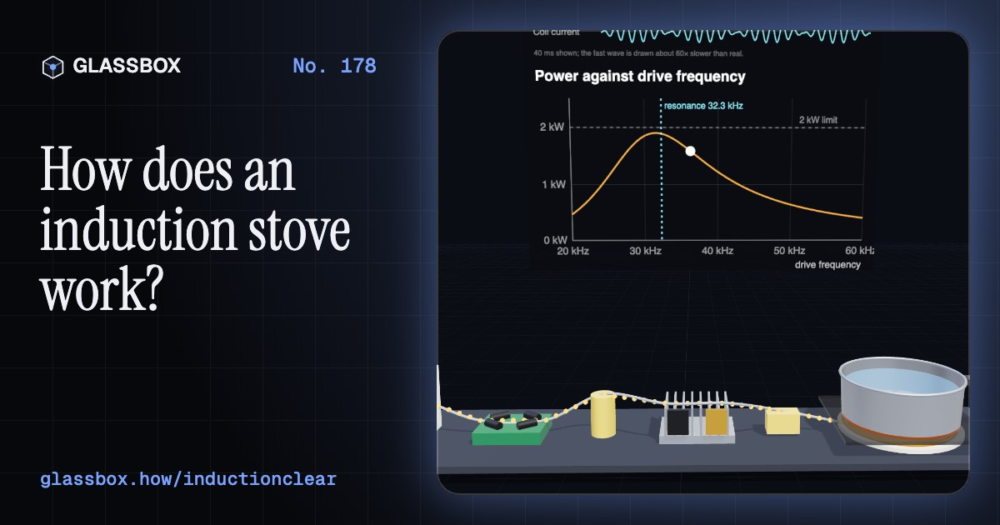
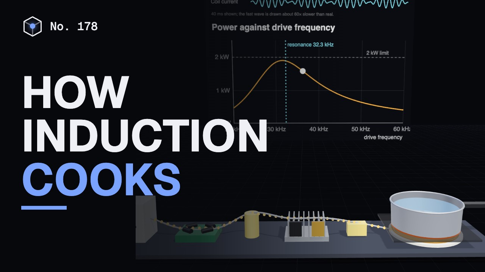
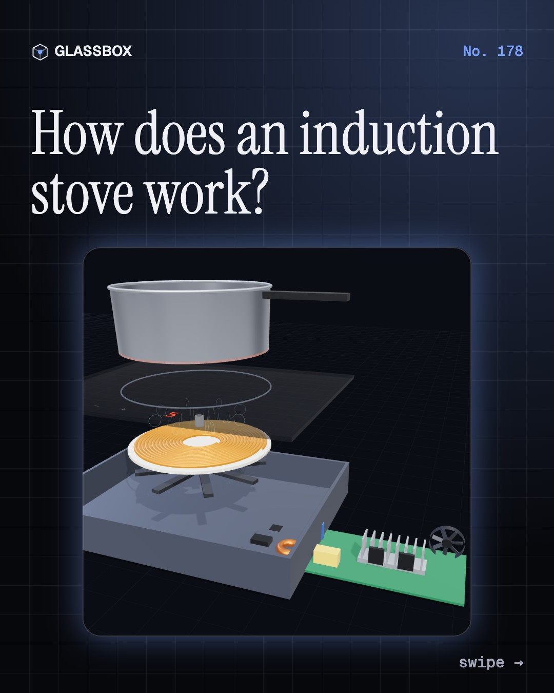
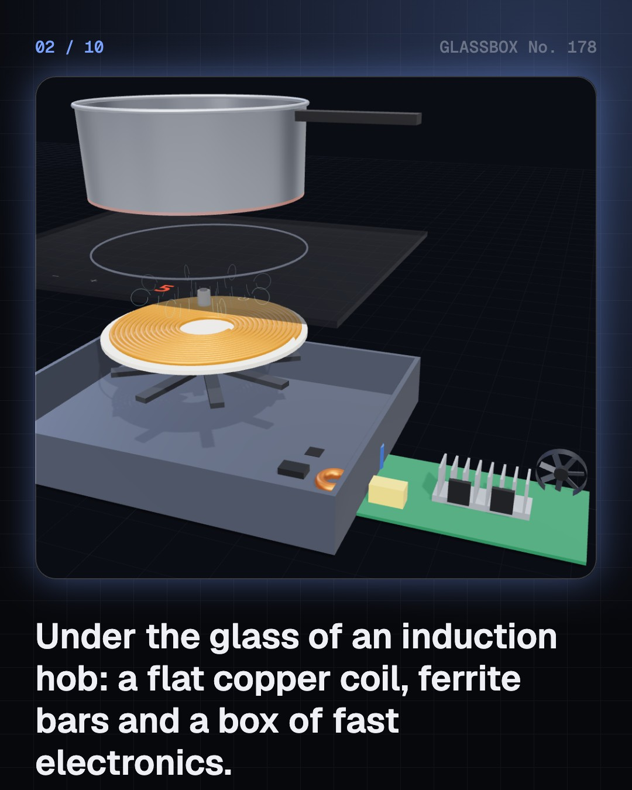
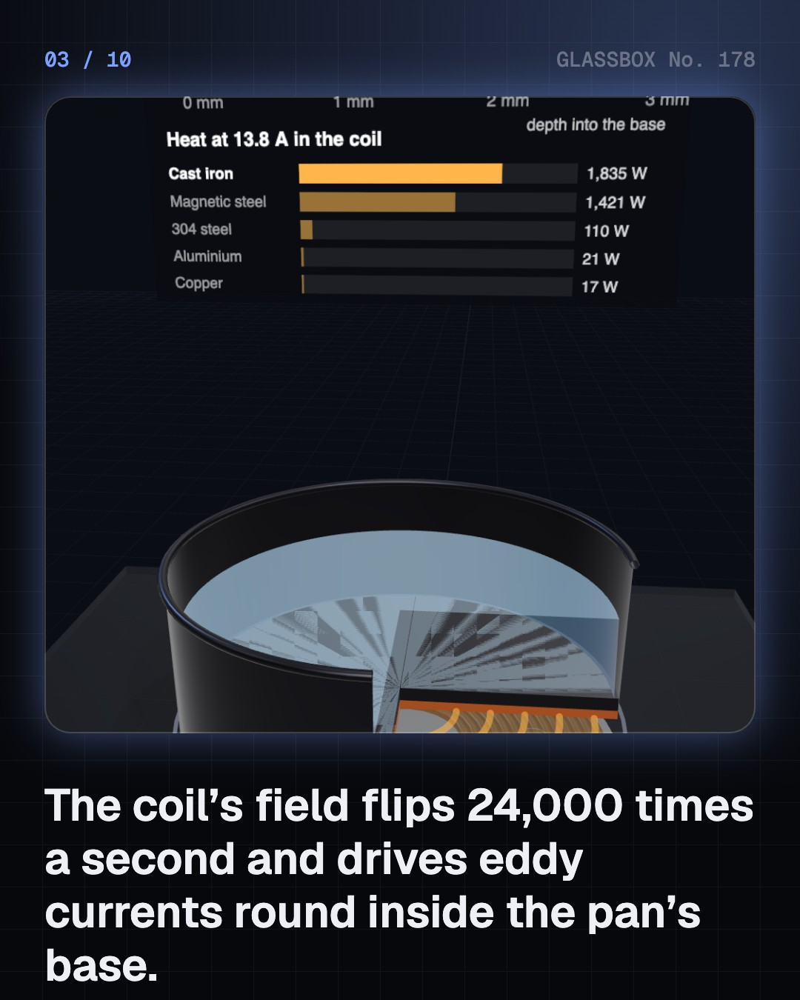
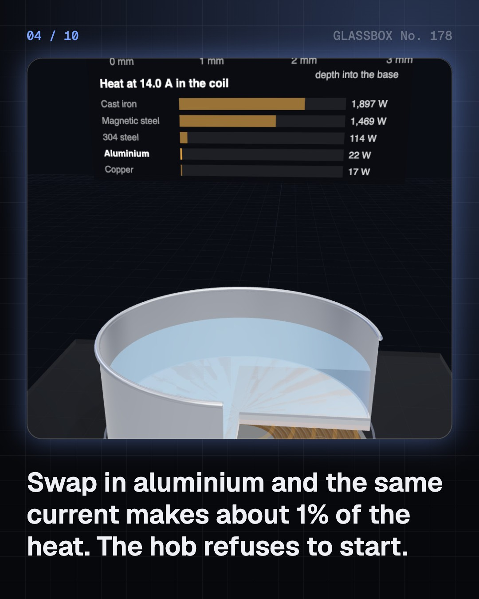

<!-- glassbox:start -->
<!-- Generated from glassbox.json by the Glassbox hub (npm run readme -- inductionclear). Edit glassbox.json, not this block. -->
<p align="center"><a href="https://glassbox.how/e/inductionclear/"></a></p>

<h1 align="center">InductionClear</h1>

<p align="center"><b>How does an induction stove work?</b><br>The glass stays cool, yet the pan boils water in three minutes. Take an induction hob apart in 3D, watch eddy currents crowd into a skin thinner than a hair, and race it against gas and an electric coil.</p>

<p align="center"><a href="https://glassbox.how/inductionclear/"><b>▶ Play with it</b></a> &nbsp;·&nbsp; <a href="https://glassbox.how/e/inductionclear/">Read the 60-second explainer</a> &nbsp;·&nbsp; <a href="https://glassbox.how/inductionclear/glassbox/reel.mp4">Watch the 40-second video</a></p>

<p align="center">
  <a href="https://glassbox.how/e/inductionclear/"></a>
  <a href="https://glassbox.how/e/inductionclear/"></a>
  <a href="LICENSE"></a>
  <a href="LICENSE-CONTENT.md"></a>
  <a href="#privacy"></a>
</p>

## In 60 seconds

1. **A coil under glass, not a heater.** Under the black glass-ceramic top sits a flat spiral coil of Litz wire with ferrite bars below it, and a board of power electronics: a rectifier, two IGBT switches on a heat sink, a capacitor and a fan. There is no hot element at all.
2. **The pan is the heater.** The coil's current swings back and forth about 24,000 times a second. Its flipping magnetic field drives eddy currents round the pan's base, and the metal's resistance turns them into heat right where the food is.
3. **Why it needs a magnetic pan.** At these frequencies the current crowds into a thin skin: about 0.23 mm in cast iron, 0.53 mm in aluminium. Iron is magnetic and resistive, so the same coil current makes about 80 times more heat in it than in aluminium. If a magnet sticks to the base, it works.
4. **Electronics tuned like a swing.** A rectifier turns the 230 V mains into DC of up to 325 V, and two IGBTs chop it into fast AC through the coil and a capacitor. The pair resonates near 32 kHz. Driving above resonance turns the power down, and a test pulse that rings too long tells the hob there is no suitable pan.
5. **Less waste on the way to the pot.** Boiling 1 litre from 25 °C needs 314 kJ whatever the stove. ENERGY STAR puts induction at about 85%, electric coils at 75–80% and US gas hobs at about 32%. India's lab rules ask at least 80% of a star-labelled induction hob and 68% of an LPG burner.
6. **A 2 kW load and a fast pan.** At 2,000 W the hob draws 8.7 A, so it needs a 16 A wall socket, not a thin extension board. An empty pan can pass 250 °C in under a minute. On an oil fire, switch off and cover with a metal lid, never water. The stray field fades quickly with distance.

## Words worth knowing

| Term | Meaning |
|---|---|
| **Electromagnetic induction** | A changing magnetic field makes a voltage, and so a current, in a nearby conductor. |
| **Eddy currents** | Loops of current that a changing magnetic field drives round inside a piece of metal, heating it. |
| **Skin depth** | How deep high-frequency current reaches into a metal; about 0.23 mm in cast iron at 24 kHz. |
| **Ferromagnetic** | Strongly magnetic, like iron and some steels. Induction hobs need a pan base made of such metal. |
| **Litz wire** | Wire of many thin insulated strands twisted together, so high-frequency current uses all of the copper. |
| **IGBT** | Insulated-gate bipolar transistor: the fast, high-current electronic switch that drives the coil. |
| **Resonance** | The frequency at which a coil and capacitor swing energy back and forth most easily, f = 1 ÷ (2π√(LC)). |
| **Efficiency** | The share of the energy you pay for that ends up in the food or water. |

## A short history

**190 years from a ring of iron in London to a 2 kW hob on an Indian kitchen counter.**

- **1831** · Faraday's induction ring (Michael Faraday, Royal Institution, London)
- **1855** · Currents that heat a disc (Léon Foucault, Paris)
- **1899** · An induction furnace melts steel (Fredrik Adolf Kjellin, Gysinge works)
- **1956** · Boiling water through a newspaper (Frigidaire, General Motors, Touring showcase)
- **1971** · The Cool Top (Westinghouse Research and Development Center, Shown in Houston, Texas)
- **1978** · The IGBT (B. Jayant Baliga, General Electric, Schenectady, New York)
- **1988** · The induction rice cooker (Matsushita Electric Industrial (now Panasonic), Japan)
- **2021** · Go Electric (Ministry of Power and BEE, New Delhi)

The full story, with 24 moments, charts, people and 27 sources: [glassbox.how/e/inductionclear/history](https://glassbox.how/e/inductionclear/history/). The data lives in [`history.json`](history.json).

## Video and slides

Made with the Glassbox studio from this box's storyboard (`window.glassbox.director`). Free to reuse under CC BY 4.0.

<a href="https://glassbox.how/inductionclear/glassbox/video.mp4"></a>

<p><a href="glassbox/slide-1.jpg"></a> <a href="glassbox/slide-2.jpg"></a> <a href="glassbox/slide-3.jpg"></a> <a href="glassbox/slide-4.jpg"></a></p>

| File | What | Size |
|---|---|---|
| [`glassbox/reel.mp4`](https://glassbox.how/inductionclear/glassbox/reel.mp4) | Reel / Short, with captions and soundtrack | 1080×1920 |
| [`glassbox/video.mp4`](https://glassbox.how/inductionclear/glassbox/video.mp4) | YouTube video, with captions and soundtrack | 1920×1080 |
| `glassbox/slide-1…10.jpg` | Instagram carousel | 1080×1350 |
| `glassbox/thumb.jpg` | YouTube thumbnail | 1280×720 |
| `glassbox/cover.jpg` | Share card and repo social preview | 1200×630 |
| [`glassbox/history-reel.mp4`](https://glassbox.how/inductionclear/glassbox/history-reel.mp4) | “History in 10 moments” Reel / Short | 1080×1920 |
| `glassbox/history-slide-*.jpg` | History carousel | 1080×1350 |
| `glassbox/post.json` | Post copy and schedule used by the publish kit | |

## Privacy

This box has no accounts and no ads, and it ships its own fonts and libraries. When you run it yourself it sends nothing anywhere. On glassbox.how, the site's `/bar.js` also loads Glassbox's analytics: **Google Analytics** to count visits (it asks first in the EU, UK and Switzerland, and stays off when your browser sends Global Privacy Control or Do Not Track) and **ClickTrust** to detect bots.

It remembers a few things **in your own browser only**, and never sends them anywhere:

| Browser storage key | What it holds |
|---|---|
| `inductionclear.v1` | Which chapters you have opened, your best quiz scores, and sound on or off. |

Exactly what each one sees is at [glassbox.how/privacy](https://glassbox.how/privacy/).

## Licences

- **Code:** [MIT](LICENSE). Use it, change it, ship it.
- **Explanations, text, images and videos** (`glassbox.json`, `glassbox/`): [CC BY 4.0](LICENSE-CONTENT.md). Credit “Glassbox, glassbox.how/e/inductionclear”.
- **Third-party parts** keep their own licences: [three.js](https://threejs.org) (MIT), [Geist, Instrument Serif](https://openfontlicense.org) (SIL OFL 1.1).
- The Glassbox name and logo aren't covered by either licence. See the [terms](https://glassbox.how/terms/).

Found a mistake? [Open an issue](https://github.com/bdeeps/inductionclear/issues). Corrections happen in public.
<!-- glassbox:end -->

## Run it

It's plain HTML, CSS and JavaScript. No build step and no dependencies. Run locally, it contacts no other website.

```bash
python3 -m http.server 8000
```

Three.js and the fonts ship in `vendor/` and `fonts/`, so it also works offline.

Then open http://localhost:8000.

## How it's built

| File | What |
|---|---|
| `index.html`, `css/app.css` | The page and its styles |
| `js/app.js`, `js/stage.js`, `js/ui.js`, `js/kit.js` | The shared Glassbox 3D engine: chapters, 3D stage, controls, quiz, video director |
| `js/chapters/*.js` | One file per chapter: the 3D model, controls, text, key terms, quiz and video scenes |
| `js/induction.js` | Shared physics (skin depth, eddy heating, the resonant tank, boiling energy and costs, labelled efficiency figures), the generic hob and pan models, and chart helpers |
| `glassbox.json` | Title, question, explainer beats, key terms, browser storage and credits shown on glassbox.how |
| `reel` in each chapter | The storyboard the Glassbox studio records into short videos |
| `glassbox/` | The published video, slides, thumbnail and post copy |
| `fonts/`, `vendor/three/` | Self-hosted Geist and Instrument Serif (SIL OFL 1.1) and three.js (MIT) |
